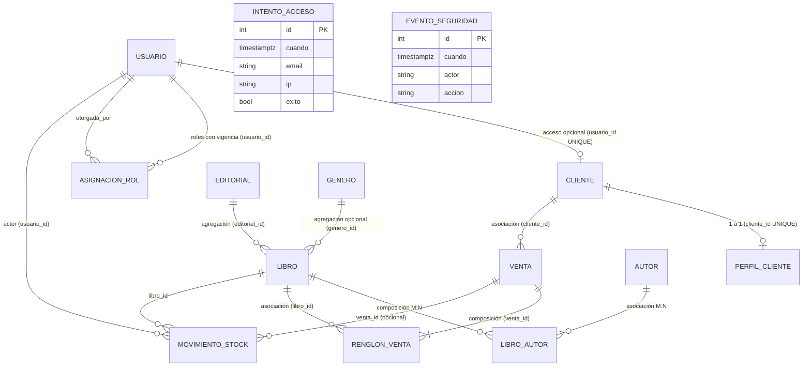

# Modelo de Datos

## Dominios
1. **Acceso y Seguridad (`usuarios`):** `Usuario`, `AsignacionRol`, `IntentoAcceso` y `EventoSeguridad`.
2. **Catálogo e Inventario (`editoriales`, `generos`, `autores`, `libros`):** `Editorial`, `Genero`, `Autor`, `Libro`, `LibroAutor` y `MovimientoStock`.
3. **Clientes (`clientes`):** `Cliente` y `PerfilCliente`.
4. **Ventas (`ventas`):** `Venta` y `RenglonVenta`.

## ERD (Diagrama de Entidad-Relación)

## Entidades

### 1. `usuario`
- **Columnas:** `id` (PK), `email` (`VARCHAR(254)`, `UNIQUE`), `nombre` (`VARCHAR(120)`), `password_hash` (`VARCHAR(255)`), `activo` (`BOOLEAN`, default `True`), `debe_cambiar_password` (`BOOLEAN`, default `False`).
- **Relaciones:** 1 a 0..1 con `Cliente` (`uselist=False`), 1 a N con `AsignacionRol` y `MovimientoStock`.
- **Restricciones:** `uq_usuario_email`. No tiene columna `rol`.

### 2. `asignacion_rol`
- **Columnas:** `id` (PK), `usuario_id` (FK → `usuario.id` `ON DELETE CASCADE`), `rol` (`VARCHAR(20)`), `desde` (`TIMESTAMPTZ`, default `now()`), `vence_en` (`TIMESTAMPTZ`, nullable), `revocada_en` (`TIMESTAMPTZ`, nullable), `otorgada_por` (FK → `usuario.id` `ON DELETE SET NULL`, nullable).
- **Restricciones e Índices:**
  - `ck_asignacion_rol_rol_valido`: `rol IN ('ADMIN', 'VENDEDOR', 'CLIENTE')`
  - `uq_asignacion_rol_usuario_rol_abierta`: Índice único parcial sobre `(usuario_id, rol) WHERE revocada_en IS NULL` (RN-03).
  - Índices de FK: `ix_asignacion_rol_usuario_id`, `ix_asignacion_rol_otorgada_por`.

### 3. `intento_acceso`
- **Columnas:** `id` (PK), `cuando` (`TIMESTAMPTZ`, default `now()`), `email` (`VARCHAR(254)`), `ip` (`VARCHAR(64)`), `exito` (`BOOLEAN`).
- **Índices:** `ix_intento_acceso_email_ip_cuando` sobre `(email, ip, cuando)`. Sin claves foráneas.

### 4. `evento_seguridad`
- **Columnas:** `id` (PK), `cuando` (`TIMESTAMPTZ`, default `now()`), `actor` (`VARCHAR(254)`), `accion` (`VARCHAR(500)`). Sin claves foráneas.

### 5. `cliente` y `perfil_cliente`
- **`cliente`:** `id` (PK), `nombre` (`VARCHAR(120)`), `email` (`VARCHAR(254)`, `UNIQUE` `uq_cliente_email`), `usuario_id` (FK → `usuario.id` `ON DELETE SET NULL`, nullable, `UNIQUE` `uq_cliente_usuario_id`). `Cliente.usuario` y `Cliente.perfil` usan `uselist=False`.
- **`perfil_cliente`:** `id` (PK), `cliente_id` (FK → `cliente.id` `ON DELETE CASCADE`, `UNIQUE` `ix_perfil_cliente_cliente_id`), `telefono` (`VARCHAR(30)`), `direccion` (`VARCHAR(200)`).

### 6. `editorial`, `genero`, `autor`, `libro` y `libro_autor`
- **`editorial`:** `id` (PK), `nombre` (`UNIQUE` `uq_editorial_nombre`), `pais`.
- **`genero`:** `id` (PK), `nombre` (`UNIQUE` `uq_genero_nombre`).
- **`autor`:** `id` (PK), `nombre`, `nacionalidad`.
- **`libro`:** `id` (PK), `isbn` (`VARCHAR(20)`), `titulo` (`VARCHAR(200)`), `precio` (`NUMERIC(10,2)`), `stock` (`INTEGER`), `borrado_en` (`TIMESTAMPTZ`, nullable), `editorial_id` (FK `RESTRICT`), `genero_id` (FK `SET NULL`, nullable).
  - **Restricciones:** `ck_libro_precio_positivo` (`precio > 0`), `ck_libro_stock_no_negativo` (`stock >= 0`), e **índice único parcial** `uq_libro_isbn_vigente` sobre `(isbn) WHERE borrado_en IS NULL`.
- **`libro_autor`:** PK compuesta `(libro_id, autor_id)`, `rol` (`CHECK rol IN ('autor', 'coautor', 'traductor', 'ilustrador')`), `orden` (`CHECK orden >= 1`).

### 7. `movimiento_stock` (Append-Only)
- **Columnas:** `id` (PK), `libro_id` (FK → `libro.id` `RESTRICT`), `venta_id` (FK → `venta.id` `RESTRICT`, nullable), `usuario_id` (FK → `usuario.id` `RESTRICT`), `cantidad` (`INTEGER`), `motivo` (`VARCHAR(200)`), `cuando` (`TIMESTAMPTZ`, default `now()`).
- **Restricciones:**
  - `ck_movimiento_stock_cantidad_no_cero`: `cantidad <> 0`.
  - Índices de FK: `ix_movimiento_stock_libro_id`, `ix_movimiento_stock_venta_id`, `ix_movimiento_stock_usuario_id`.
  - **Disparador en BD (`trg_movimiento_stock_solo_agregado`):** Instalado en la 4ª migración; rechaza cualquier `UPDATE` o `DELETE` sobre la tabla (RN-12).

### 8. `venta` y `renglon_venta`
- **`venta`:** `id` (PK), `cliente_id` (FK → `cliente.id` `RESTRICT`), `fecha` (`TIMESTAMPTZ`), `total` (`NUMERIC(12,2)`, `CHECK total >= 0`).
- **`renglon_venta`:** `id` (PK), `venta_id` (FK → `venta.id` `CASCADE`), `libro_id` (FK → `libro.id` `RESTRICT`), `cantidad` (`CHECK cantidad > 0`), `precio_unitario` (`NUMERIC(10,2)`, `CHECK precio_unitario > 0`), `UNIQUE (venta_id, libro_id)`.

## Seed data inicial (`seed.py`, páginas 19–20)
- **Usuarios (5):**
  - `admin@example.com` (`ADMIN`)
  - `admin2@example.com` (`ADMIN`)
  - `vendedor@example.com` (`VENDEDOR`)
  - `ana@example.com` (`CLIENTE`)
  - `nuevo@example.com` (`VENDEDOR`, con `debe_cambiar_password = True`)
- **Catálogo:** 3 editoriales, 3 géneros y 6 autores del TP.
- **Libros (5) y Movimientos:**
  - *Rayuela*: stock inicial `11`, salida venta 1 `-1` → **stock actual `10`**.
  - *Antología de la literatura fantástica*: stock inicial `5` → **stock actual `5`**.
  - *Ficciones*: stock inicial `10`, salida venta 1 `-2` → **stock actual `8`**.
  - *Respiración artificial*: stock inicial `3` → **stock actual `3`**.
  - *Bestiario*: stock inicial `1` → **stock actual `1`**.
- **Clientes (3):** Lucía Fernández (con perfil, sin usuario), Tomás Ríos (sin perfil, sin usuario) y Ana Paz (vinculada a `ana@example.com`).
- **Venta inicial (1):** De Lucía Fernández, registrada por `vendedor@example.com`: 1 *Rayuela* ($25.000) y 2 *Ficciones* ($22.000 c/u) → total `69000.00`, con sus 2 movimientos de salida (`-1` y `-2`).
- **Historial de seguridad:** 1 fila en `evento_seguridad` con `actor = "SISTEMA"` y `accion = "Carga de los datos iniciales"`.
